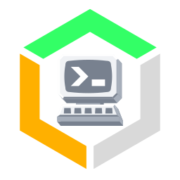
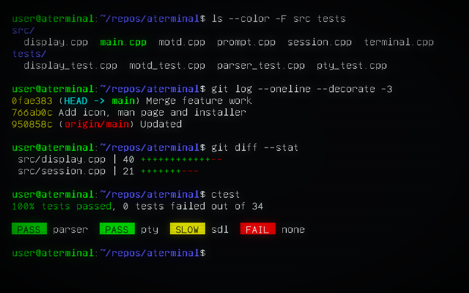
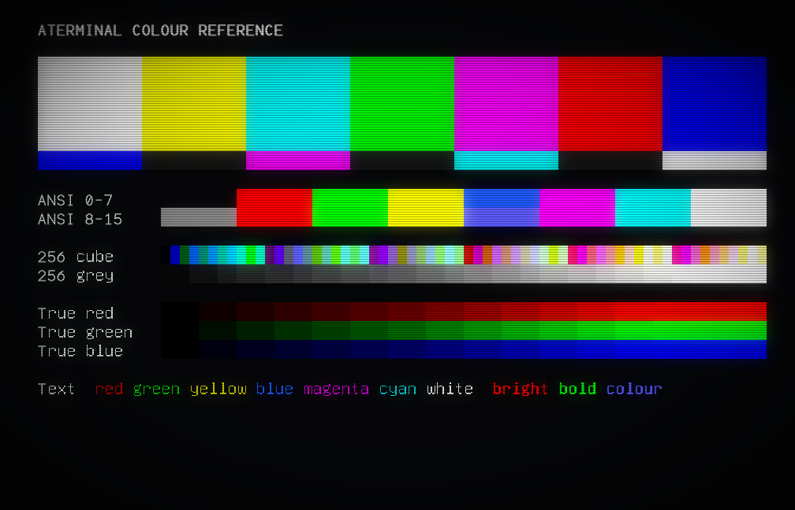

<p align="center"></p>

# aterminal


<p align="left"><a href="https://snapcraft.io/aterminal"></a></p>

A native Linux terminal with the look of a phosphor CRT: green or amber text, or a
colour tube, with soft bloom, scanlines, a vignette, and optional AdLib-style key
sounds. Written in C++17 with SDL2 as its only external library dependency.

Twelve independent shell consoles live behind F1-F12. There are no console tabs,
toolbars, or clickable console selectors. The display stays focused on the shell.

aterminal implements a practical VT100/ANSI subset with Unicode extensions, not
complete xterm compatibility. Read [Compatibility](#compatibility) before using
it with applications that depend on advanced terminal features.

## Screenshots

### Green Phosphor


### Amber Phosphor


### Colour CRT



All three are actual captures of the same scripted sample session, at 960 x 600
pixels with text zoom 2. In green and amber, colours become phosphor brightness,
and black text on a coloured background becomes reverse video. To display the
session yourself:

```sh
./build/aterminal --colour=colour --text-size=2 --size=960x600 --hold -- sh docs/sample-session.sh
```

### Colour Reference



To display this chart in your own terminal:

```sh
./build/aterminal --colour=colour --geometry=80x25 --hold -- sh docs/colour-bars.sh
```

The colour mode shows the 16 ANSI colours with these values. Bold text uses the
bright value of the eight standard colours. Background colour 0 shows the near-black
screen, `#060709`.

| Index | Colour | Value | Index | Bright colour | Value |
| --- | --- | --- | --- | --- | --- |
| 0 | Black | `#000000` | 8 | Bright black | `#7F7F7F` |
| 1 | Red | `#CD0000` | 9 | Bright red | `#FF0000` |
| 2 | Green | `#00CD00` | 10 | Bright green | `#00FF00` |
| 3 | Yellow | `#CDCD00` | 11 | Bright yellow | `#FFFF00` |
| 4 | Blue | `#1E5AEE` | 12 | Bright blue | `#5C5CFF` |
| 5 | Magenta | `#CD00CD` | 13 | Bright magenta | `#FF00FF` |
| 6 | Cyan | `#00CDCD` | 14 | Bright cyan | `#00FFFF` |
| 7 | White | `#E5E5E5` | 15 | Bright white | `#FFFFFF` |

Default text is `#D7DEDA`, and default bold text is `#FFFFFF`.

## Features

- Twelve isolated Linux PTY sessions, created on demand with F1-F12.
- Retro stroke glyphs with aligned bitmap fallback for lowercase and Unicode.
- Green or amber phosphor or a colour CRT, with independently switchable effects.
- UTF-8 input, CJK glyphs, combining marks, and basic monochrome emoji support.
- Synthetic bold, italic, underline, reverse video, and strikethrough attributes.
- Mouse selection, clipboard copy/paste, and 10,000 scrollback lines per console.
- Mouse reporting for terminal applications (xterm modes 1000, 1002, 1003 and SGR 1006), so tools such as Copilot CLI can use clicks, drags and the wheel.
- Resizable windows, six text zoom levels, and Alt+Enter fullscreen switching.
- Optional synthesized key clicks; no recorded sound assets are required.

The software renderer and AdLib synthesizer come from
[Space Paranoids](https://github.com/ross-newman/space-paranoids), and the files
used are included in `third_party/`. There is no Qt, SDL_ttf, FreeType, libvterm, browser engine, or Google gflags dependency.

## Requirements

| Component | Requirement |
| --- | --- |
| Platform | Linux with a graphical desktop and pseudo-terminal support |
| Compiler | C++17-capable GCC or Clang |
| Build system | CMake 3.22 or newer |
| External library | SDL2 development headers and library |
| Font data | Bundled GNU Unifont 16.0.04 bitmap asset |

Install the build prerequisites for your distribution:

```sh
sudo apt install build-essential cmake libsdl2-dev        # Debian, Ubuntu
sudo dnf install gcc-c++ cmake make SDL2-devel            # AlmaLinux 9, needs CRB
sudo pacman -S --needed base-devel cmake sdl2-compat      # Arch Linux
```

On AlmaLinux 9, enable CRB first with `sudo dnf config-manager --set-enabled crb`.
AlmaLinux 10 has no `SDL2-devel`; install `sdl2-compat-devel` from its `devel`
repository, as [the CI workflow](.github/workflows/build.yml) does.

## Build And Run

Run these commands from the aterminal checkout:

```sh
cmake -S . -B build -DCMAKE_BUILD_TYPE=Release
cmake --build build -j
ctest --test-dir build --output-on-failure
./build/aterminal
```

The application starts `$SHELL`, or `/bin/sh` if it is unset, in the directory
from which aterminal was launched. `--shell` selects a different shell and
requires an absolute executable path.

### Examples

```sh
./build/aterminal --colour=amber --size=1280x800 --text-size=3
./build/aterminal --green --fullscreen --no-sound
./build/aterminal --demo
./build/aterminal --motd
./build/aterminal --motd=haiku --amber
./build/aterminal --shell /bin/bash -e 'htop'
./build/aterminal -c 'cd ~/repos && git status'
./build/aterminal --colour=colour --prompt=slackware --geometry=132x43
./build/aterminal -d ~/repos --title Build -- make test
./build/aterminal -h
```

`-e` passes one command string to the selected shell using `-c`. Quote the
command as one argument. That command is also used for newly opened consoles,
and each console ends when its command does.

`-c` leaves you at an interactive prompt afterwards. It runs once, in the first
console only, and cannot be combined with `-e` or `--demo`. Under bash it runs
after `~/.bashrc`, so aliases work; other shells run it before their startup files.

`--` runs a program directly with its arguments, so nothing needs shell quoting.
It applies to every console and must come last on the command line.

The window title shows the console and its size in characters, such as
`aterminal / F1 / 80x25`, and updates as you resize or zoom.

### Install

`install.sh` builds aterminal, installs it, and refreshes the desktop menu, icon,
and man page caches:

```sh
./install.sh                 # /usr/local, using sudo if needed
./install.sh --user          # $HOME/.local, without root access
./install.sh --prefix /opt/aterminal
```

To install from the Snap Store:

```sh
sudo snap install aterminal --classic
```

To build and install a package instead:

```sh
./install.sh --deb && sudo apt install ./build/aterminal_*.deb     # Debian, Ubuntu
./install.sh --rpm && sudo dnf install ./build/aterminal-*.rpm     # AlmaLinux
cd packaging/arch && makepkg --install                             # Arch Linux
```

The package version comes from the `VERSION` file, and the package manager works
out the library dependencies.

### Releases

Every push builds and tests on Ubuntu 22.04, 24.04 and 26.04, AlmaLinux 9 and 10,
and Arch Linux. Ubuntu 22.04 and 26.04 are also cross-compiled for arm64
(`packaging/cross-arm64-deb.sh`, run as root on amd64 Ubuntu); those builds are
packaged but not tested, as the tests need arm64 hardware.
Pushing a tag such as `v0.1.0` also publishes a GitHub release with the `.deb`,
`.rpm` and Arch packages for each, the snap, and a `SHA256SUMS` file. The tag must match the `VERSION`
file.

The snap is also published to the Snap Store when a version tag is pushed, to the
`stable` channel. Publishing needs a
`SNAPCRAFT_STORE_CREDENTIALS` repository secret, made with
`snapcraft export-login --snaps=aterminal --acls=package_access,package_push,package_update,package_release -`.
To build the snap locally, run `snapcraft pack`.

To make a release, update `VERSION` and [CHANGELOG.md](CHANGELOG.md), run
`./update_readme_version.sh`, commit, and push a tag that matches `VERSION`.

Installation includes the executable, a desktop menu entry and icon, a man page, Unicode font data, documentation,
screenshots, and upstream notices. Keep the installed font data alongside the
executable's installation prefix; copying only the executable is not a portable
installation.

## Command-Line Flags

Value flags accept `--flag=value` or `--flag value`. Command-line choices
override saved preferences; if a setting appears more than once, the last wins.

| Flag | Purpose |
| --- | --- |
| `-h`, `--help` | Show flags and keyboard shortcuts, then exit |
| `--size WIDTHxHEIGHT` | Initial window size in pixels; default fits 80x25 cells at the text size in use |
| `--width N`, `--height N` | Set dimensions separately; width 400-4096, height 280-2160 |
| `--text-size N` | Initial zoom level, 1-6; default 6, lowered if needed to fit the screen |
| `--colour green\|amber\|colour`, `--color ...` | Choose green or amber phosphor, or a colour CRT |
| `--green`, `--amber` | Short aliases for phosphor colour |
| `--fullscreen` | Start in desktop fullscreen; accepts `=true`, `=false`, `=1`, or `=0` |
| `--windowed` | Start windowed |
| `--sound`, `--no-sound` | Enable or disable synthesized key clicks |
| `--no-crt` | Disable bloom, scanlines, and vignette |
| `--bitmap` | Use bitmap glyphs throughout instead of the mixed retro font |
| `--shell /path/to/shell` | Select the shell executable |
| `-e 'command'`, `--command 'command'` | Run a command inside the selected shell |
| `-c 'command'`, `--startup 'command'` | Run a command at startup, then continue in an interactive shell |
| `-- program args...` | Run a program directly instead of a shell; must come last |
| `--geometry COLUMNSxROWS` | Initial size in characters; default 80x25 |
| `-d DIR`, `--working-directory DIR` | Start consoles in DIR |
| `--title TEXT` | Replace "aterminal" in the window title |
| `--maximized` | Start maximised |
| `--console N` | Open on console N, 1-12 |
| `--scrollback N` | Keep N history lines per console, 0-1000000; default 10000 |
| `-l`, `--login` | Start a login shell |
| `--hold` | Keep a console open when its process ends, showing the exit status |
| `--prompt STYLE`, `--prompt=list` | Choose the bash prompt, or give your own text; default `redhat`, `none` keeps yours |
| `--cursor block\|bar\|underline` | Choose the cursor shape |
| `--no-blink` | Keep the cursor steady |
| `--scanlines N`, `--bloom N` | CRT effect strength, 0-100 percent; default 100 |
| `--bell visual\|audible\|none` | Flash, click, or ignore the bell; default visual |
| `--config FILE` | Read options from FILE |
| `--demo` | Display the built-in font and terminal demonstration, then open a shell |
| `--motd`, `--motd NAME`, `--motd=NAME` | Show a message of the day on each new console; no name picks at random |
| `--motd=list` | List the available messages, then exit |
| `--self-test` | Run the SDL interaction checks without loading or saving preferences |
| `--frames N` | Exit after N event-loop iterations, 1-1000000; not a duration in seconds |
| `--screenshot PATH` | Save the final rendered display as PNG when the application exits |

`--motd` messages are `welcome`, `tips`, `sysop`, `phosphor`, `unix`, `haiku`,
`bbs`, and `launch`. With `random`, each console picks its own, and a restarted
shell picks again. `--motd` cannot be combined with `--demo`, which clears the
screen.

Fullscreen follows the desktop display size. The window size specifies the
windowed dimensions. Alt+Enter switches modes without consuming a console key.

## Controls

| Key | Action |
| --- | --- |
| F1-F12 | Switch to that console, creating it on first use; Shift+F1-F12 and Ctrl+F1-F12 go to the application |
| Ctrl+Shift+Alt+Plus / Minus | Increase / decrease text size |
| Ctrl+Shift+A / G | Amber / green phosphor |
| Ctrl+Shift+O | Toggle colour CRT |
| Ctrl+Shift+S | Toggle AdLib key sounds; disabling clears queued sound |
| Ctrl+Shift+R | Toggle CRT bloom, scanlines and vignette |
| Ctrl+Shift+B | Toggle all-bitmap font mode |
| Alt+Enter / Ctrl+Shift+F | Toggle fullscreen; F11 still selects console 11 |
| Ctrl+Shift+P or right click | Open / close terminal setup |
| Escape | Close setup |
| Mouse drag | Select text; a single click clears selection |
| Mouse click / drag / wheel | Sent to the application when it enables mouse tracking; hold Shift to select, paste, or open setup instead |
| Ctrl+C | Copy selected text and clear selection; interrupt when nothing is selected |
| Ctrl+Shift+C | Copy selected text without sending an interrupt |
| Ctrl+V / Ctrl+Shift+V / Shift+Insert | Paste the clipboard |
| Middle click | Paste the selected text, including text selected in other applications; the clipboard if nothing is selected |
| Ctrl+Z / Ctrl+Y | Forward to the shell/application (usually suspend / yank in shells) |
| Mouse wheel / Shift+PageUp / Shift+PageDown | Scrollback by wheel step or page |
| Shift+Up / Shift+Down | Scroll the scrollback one line |
| Shift+Home / Shift+End | Jump to the oldest scrollback line / back to the live screen |
| Ctrl+Shift+Enter | Restart a console kept open after its process ended |

Right click opens the setup panel for display colour mode, sound, CRT effects, and
font mode. Console switching remains function-key-only.

Ctrl+Z and Ctrl+Y are passed through as terminal control characters, so editors
and shells apply their own bindings. They do not undo or redo terminal output.
Ctrl+Z normally suspends the foreground job; use `fg` in the shell to resume it.

## Retro Prompts

Under bash, aterminal starts with a period prompt, `redhat` by default. `--prompt`
selects another. `~/.bashrc` still runs; only the prompt changes, and only in
aterminal. Text before the final symbol is bold.

| Style | Looks like | From |
| --- | --- | --- |
| `slackware` | `user@host:~/dir$` | Early Linux, 1993 |
| `debian` | `host:~/dir$` | Early Debian |
| `redhat` | `[user@host dir]$` | Classic Red Hat; the default |
| `bsd` | `host%` | BSD csh |
| `sunos` | `host 12%` | SunOS csh, with the history number |
| `unix` | `$` | Basic UNIX prompt |
| `bourne` | `$` | Original Unix shell |
| `bash` | `bash-5.2$` | Stock bash with no startup files |
| `dos` | `C:\HOME\USER>` | MS-DOS |
| `none` | Your own prompt | Your shell startup files |

To use your own text, pass anything containing a symbol or space, such as
`--prompt='$'` or `--prompt='ready> '`. A space is added after it if needed, and bash
prompt escapes such as `\h` and `\w` work. A plain word is treated as a style name,
so a mistyped style gives an error.

Choosing a prompt needs an interactive bash shell, so it cannot be combined with `-e`
or `--`. The `$` becomes `#` for root, as it always has.

## Config Files

`--config FILE` reads one option per line, without the leading dashes, as
`name value`, `name=value`, or `name`. Blank lines and lines starting with `#` are
ignored. Options take effect where `--config` appears, so later command-line
options override the file:

```text
# ~/.config/aterminal.conf
colour colour
prompt slackware
geometry 132x43
no-blink
```

```sh
./build/aterminal --config ~/.config/aterminal.conf --amber
```

## Sessions And Preferences

The window opens at 80 columns by 25 rows unless a size is given. The pixel size
follows the text zoom, so 80x25 at zoom 6 is 2928x1848. On a screen too small for
that, the default zoom steps down until the console fits. Resizing or zooming
later changes the row and column counts.

Each console starts its own PTY when first visited. Background consoles keep
processing output. Window resizing and zoom changes update every open PTY's
dimensions.

When a console's shell or command ends, as with `exit`, the console closes and
aterminal moves to the next open one. Closing the last console quits aterminal.
A shell started from another shell just returns to it, as usual. With `--hold` the
console stays open instead, and a command that could not run, with status 126 or
127, also stays open so its error can be read.

Under bash, consoles start with the classic Red Hat prompt; see
[Retro Prompts](#retro-prompts). With `--prompt=none`, you keep the prompt from your
startup files, bold up to the `$`. aterminal runs `~/.bashrc` as usual and then
adjusts `PS1`, so `~/.bashrc` itself is not changed. Other shells keep their own
prompt.

Scrollback applies to the normal screen. Full-screen applications such as `vim`
and `less` have none, so Shift+PageUp and Shift+PageDown do nothing inside them, and
Shift+Up, Shift+Down, Shift+Home and Shift+End go to the application instead.
A scrolled view stays on the same lines as new output arrives, and typing
returns to the live screen.

Closing the application closes its PTYs and terminates its shell processes.
Sessions are not persistent or restored across launches. Save work before closing
the window; use a session manager such as `tmux` when persistence is needed,
subject to the compatibility limits below.

Display colour mode, sound, CRT effects, and font mode are saved on normal exit.
Other command-line options apply to that run only. Text zoom,
window dimensions, fullscreen state, and shell sessions are not saved. SDL stores
preferences at:

```text
${XDG_DATA_HOME:-$HOME/.local/share}/ross-newman/aterminal/preferences
```

Remove that file while aterminal is closed to reset saved settings. Self-tests
neither load nor save these preferences.

## Compatibility

The Space Paranoids vector-stroke renderer draws its supported retro glyphs.
GNU Unifont 16.0.04 bitmap data supplies lowercase, remaining punctuation,
international characters, box drawing and monochrome emoji without a font library.
Stroke capitals and bitmap lowercase share a baseline at every zoom level.

Supported terminal behaviour includes cursor movement, erase/insert/delete,
scroll regions, tab stops, repeat, soft reset, DEC line graphics with G0/G1
switching, saved cursor, alternate screens, cursor queries, application cursor
keys, bracketed paste, and SGR text attributes. In green and
amber modes, ANSI indexed and truecolour values are mapped to phosphor brightness.
The colour CRT mode displays them in colour.

### Text Styles

SGR `1` thickens and brightens text; SGR `3` adds a modest italic slant. They can
be combined. SGR `22` and `23` reset bold and italic independently; SGR `0` resets
all text attributes. These are synthetic styles, not separate font faces, and
are clipped to the fixed cell grid in both font modes.

```sh
printf '\033[1mBold\033[0m  \033[3mItalic\033[0m  \033[1;3mBoth\033[0m\n'
```

### Known Limits

- The application advertises `TERM=xterm-256color` for modern applications but
does not implement every xterm sequence or claim formal VT100 certification.
- Plain F1-F12 and Alt+F1-F12 select consoles and are not forwarded to terminal applications. Shift or Ctrl with F1-F12, and F13-F20, are sent as xterm sequences.
- Insert, Delete, PageUp, PageDown, arrows, Home, End and function keys carry Shift, Alt and Ctrl as xterm modifier parameters. Alt adds an Escape prefix to Backspace, Tab and Escape (Alt+Enter is fullscreen); Ctrl+Backspace sends `^H`.
- Ctrl+2 to Ctrl+8, Ctrl+/ and Ctrl+- send the control characters `^@` to `^?`.
- The keypad follows NumLock, and switches to VT100 application sequences when an application sends `ESC =`.
- Focus in and out reports (`ESC[?1004h`) are sent to the active console.
- Emoji are monochrome. Joined emoji preserve their codepoints for copying but
display the base glyph instead of a fully shaped ligature.
- Complex-script shaping, bidirectional layout, and complete Unicode grapheme
and character-width rules are not implemented. Missing glyphs show `?`.
- Sixel graphics, OSC clipboard access, mouse encodings other than the default and SGR 1006 (such as UTF-8 1005 and urxvt 1015), and DEC double-height text are not implemented.
- Windows and macOS are not supported by the Linux PTY implementation.

The current tests exercise specific supported behaviour, not comprehensive
compatibility with every shell, editor, or terminal application.

## Troubleshooting

| Problem | Action |
| --- | --- |
| SDL2 is missing during configuration | Install your distribution's SDL2 development package |
| Unicode bitmap font cannot be found | Keep `assets/unifont.hex` in the source tree, or reinstall with the font asset |
| No audio device or unwanted key sounds | Start with `--no-sound`; audio-device failures do not stop the terminal |
| Unexpected colour or text size | Supply `--colour` and `--text-size`, or reset the preferences file |
| An application needs plain F1-F12 | Use Shift or Ctrl with the key, or its alternative bindings; plain F-keys are reserved for consoles |
| A terminal application renders incorrectly | Check the known limits; use a fuller emulator for unsupported features |

## Verification

```sh
ctest --test-dir build --output-on-failure
./build/aterminal --self-test --amber --screenshot build/amber.png
```

Tests cover ANSI parsing, Unicode and malformed input, real PTY input/output and
resize, session isolation, mixed-case baselines, bold/italic rendering, glyph
pixels, minimum window size, startup flags, fullscreen switching, mouse selection,
clipboard operations, control keys, both phosphor palettes, mute, and audio
synthesis. CTest's SDL interaction checks use dummy video and audio drivers.

For issue reports, include the build version from CMake, Linux distribution,
SDL2 version, launch flags, shell, a minimal reproducing command, and relevant
terminal output or a screenshot. Do not include passwords, tokens, or private
terminal contents.

## Attribution And Licensing

See [THIRD-PARTY.md](THIRD-PARTY.md) for reused renderer, synthesizer, and font
details. The Space Paranoids renderer and AdLib library carry their upstream
MIT notices; GNU Unifont has separate font licensing in
[assets/UNIFONT-LICENSE.txt](assets/UNIFONT-LICENSE.txt).

aterminal is released under the [MIT License](LICENSE). The Astute Terminal name,
logo, and icons in `images/` are not covered by it; all rights to them are reserved
by Astute Systems.
