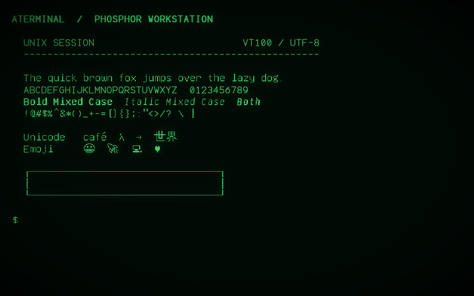
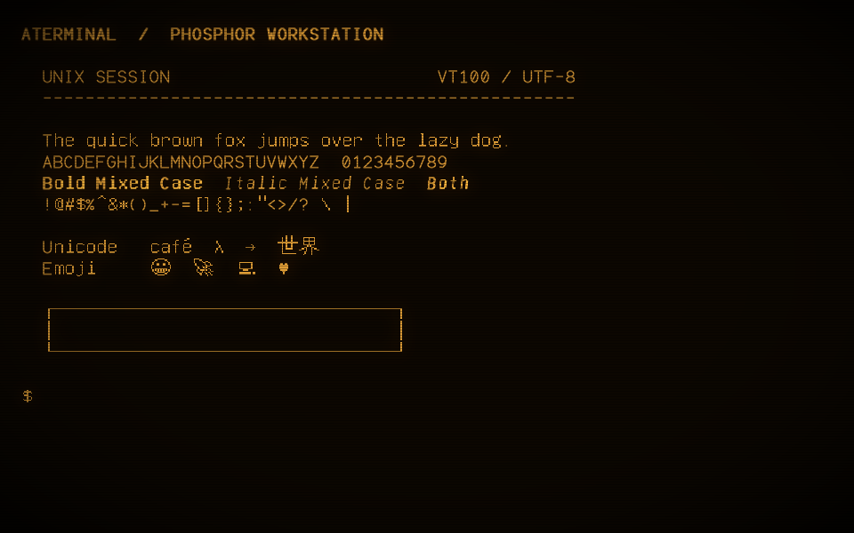

# aterminal


A native Linux terminal with the look of a phosphor CRT: green or amber text,
soft bloom, scanlines, a vignette, and optional AdLib-style key sounds. Written
in C++17 with SDL2 as its only external library dependency.

A native Linux terminal with the look of a phosphor CRT: green or amber text,
soft bloom, scanlines, a vignette, and optional AdLib-style key sounds. Written
in C++17 with SDL2 as its only external library dependency.

Twelve independent shell consoles live behind F1-F12. There are no console tabs,
toolbars, or clickable console selectors. The display stays focused on the shell.

aterminal implements a practical VT100/ANSI subset with Unicode extensions, not
complete xterm compatibility. Read [Compatibility](#compatibility) before using
it with applications that depend on advanced terminal features.

## Versioning

The project version is managed by the `VERSION` file in the repository root.
To update the version:
1. Update the `VERSION` file (e.g., from `0.1.0` to `0.2.0`).
2. Update the badge URL in `README.md` to reflect the new version.
3. Commit the changes.

The version number used in the badge and title should always match the content of the `VERSION` file.

### Green Phosphor



### Amber Phosphor



Actual application captures using the built-in demonstration session, at
960 x 600 pixels with text zoom 2. Emoji are monochrome, matching the phosphor.

## Features

- Twelve isolated Linux PTY sessions, created on demand with F1-F12.
- Retro stroke glyphs with aligned bitmap fallback for lowercase and Unicode.
- Green or amber phosphor, with independently switchable CRT effects.
- UTF-8 input, CJK glyphs, combining marks, and basic monochrome emoji support.
- Synthetic bold, italic, underline, reverse video, and strikethrough attributes.
- Mouse selection, clipboard copy/paste, and 10,000 scrollback lines per console.
- Resizable windows, six text zoom levels, and Alt+Enter fullscreen switching.
- Optional synthesized key clicks; no recorded sound assets are required.

The software renderer and AdLib synthesizer are reused directly from
[Space Paranoids](https://github.com/ross-newman/space-paranoids). There is no Qt,
SDL_ttf, FreeType, libvterm, browser engine, or Google gflags dependency.

## Requirements

| Component | Requirement |
| --- | --- |
| Platform | Linux with a graphical desktop and pseudo-terminal support |
| Compiler | C++17-capable GCC or Clang |
| Build system | CMake 3.22 or newer |
| External library | SDL2 development headers and library |
| Reused source | Space Paranoids checkout containing `engine/` and `adlib/` |
| Font data | Bundled GNU Unifont 16.0.04 bitmap asset |

On Debian or Ubuntu, install the build prerequisites:

```sh
sudo apt install build-essential cmake libsdl2-dev
```

Space Paranoids is required at build time, not at runtime. By default CMake
expects the two checkouts to be siblings:

```text
repos/
|-- aterminal/
|-- space-paranoids/
```

## Build And Run

Run these commands from the aterminal checkout:

```sh
cmake -S . -B build -DCMAKE_BUILD_TYPE=Release
cmake --build build -j
ctest --test-dir build --output-on-failure
./build/aterminal
```

For a differently located Space Paranoids checkout:

```sh
cmake -S . -B build -DCMAKE_BUILD_TYPE=Release -DSPACE_PARANOIDS_DIR=/absolute/path/to/space-paranoids
```

The application starts `$SHELL`, or `/bin/sh` if it is unset, in the directory
from which aterminal was launched. `--shell` selects a different shell and
requires an absolute executable path.

### Examples

```sh
./build/aterminal --colour=amber --size=1280x800 --text-size=3
./build/aterminal --green --fullscreen --no-sound
./build/aterminal --demo
./build/aterminal --motd
./build/aterminal --motd=haiku --amber
./build/aterminal --shell /bin/bash -e 'htop'
./build/aterminal -h
```

`-e` passes one command string to the selected shell using `-c`. Quote the
command as one argument. That command is also used for newly opened consoles.

### Install

Install for the current user without root access:

```sh
cmake --install build --prefix "$HOME/.local"
"$HOME/.local/bin/aterminal"
```

Installation includes the executable, Unicode font data, documentation,
screenshots, and upstream notices. Keep the installed font data alongside the
executable's installation prefix; copying only the executable is not a portable
installation.

## Command-Line Flags

Value flags accept `--flag=value` or `--flag value`. Command-line choices
override saved preferences; if a setting appears more than once, the last wins.

| Flag | Purpose |
| --- | --- |
| `-h`, `--help` | Show flags and keyboard shortcuts, then exit |
| `--size WIDTHxHEIGHT` | Initial window size in pixels; default fits 80x25 cells at the text size in use |
| `--width N`, `--height N` | Set dimensions separately; width 400-4096, height 280-2160 |
| `--text-size N` | Initial zoom level, 1-6; default 6, lowered if needed to fit the screen |
| `--colour green\|amber`, `--color green\|amber` | Choose phosphor colour |
| `--green`, `--amber` | Short aliases for phosphor colour |
| `--fullscreen` | Start in desktop fullscreen; accepts `=true`, `=false`, `=1`, or `=0` |
| `--windowed` | Start windowed |
| `--sound`, `--no-sound` | Enable or disable synthesized key clicks |
| `--no-crt` | Disable bloom, scanlines, and vignette |
| `--bitmap` | Use bitmap glyphs throughout instead of the mixed retro font |
| `--shell /path/to/shell` | Select the shell executable |
| `-e 'command'`, `--command 'command'` | Run a command inside the selected shell |
| `--demo` | Display the built-in font and terminal demonstration, then open a shell |
| `--motd`, `--motd NAME`, `--motd=NAME` | Show a message of the day on each new console; no name picks at random |
| `--motd=list` | List the available messages, then exit |
| `--self-test` | Run the SDL interaction checks without loading or saving preferences |
| `--frames N` | Exit after N event-loop iterations, 1-1000000; not a duration in seconds |
| `--screenshot PATH` | Save the final rendered display as PNG when the application exits |

`--motd` messages are `welcome`, `tips`, `sysop`, `phosphor`, `unix`, `haiku`,
`bbs`, and `launch`. With `random`, each console picks its own, and a restarted
shell picks again. `--motd` cannot be combined with `--demo`, which clears the
screen.

Fullscreen follows the desktop display size. The window size specifies the
windowed dimensions. Alt+Enter switches modes without consuming a console key.

## Controls

| Key | Action |
| --- | --- |
| F1-F12 | Switch to that console, creating it on first use |
| Ctrl+Shift+Alt+Plus / Minus | Increase / decrease text size |
| Ctrl+Shift+A / G | Amber / green phosphor |
| Ctrl+Shift+S | Toggle AdLib key sounds; disabling clears queued sound |
| Ctrl+Shift+R | Toggle CRT bloom, scanlines and vignette |
| Ctrl+Shift+B | Toggle all-bitmap font mode |
| Alt+Enter / Ctrl+Shift+F | Toggle fullscreen; F11 still selects console 11 |
| Ctrl+Shift+P or right click | Open / close terminal setup |
| Escape | Close setup |
| Mouse drag | Select text; a single click clears selection |
| Ctrl+C | Copy selected text and clear selection; interrupt when nothing is selected |
| Ctrl+Shift+C | Copy selected text without sending an interrupt |
| Ctrl+V / Ctrl+Shift+V / Shift+Insert / middle click | Paste |
| Ctrl+Z / Ctrl+Y | Forward to the shell/application (usually suspend / yank in shells) |
| Mouse wheel / Shift+PageUp / Shift+PageDown | Scrollback |
| Ctrl+Shift+Enter | Restart the current shell after it exits |

Right click opens the setup panel for phosphor colour, sound, CRT effects, and
font mode. Console switching remains function-key-only.

Ctrl+Z and Ctrl+Y are passed through as terminal control characters, so editors
and shells apply their own bindings. They do not undo or redo terminal output.
Ctrl+Z normally suspends the foreground job; use `fg` in the shell to resume it.

## Sessions And Preferences

The window opens at 80 columns by 25 rows unless a size is given. The pixel size
follows the text zoom, so 80x25 at zoom 6 is 2928x1848. On a screen too small for
that, the default zoom steps down until the console fits. Resizing or zooming
later changes the row and column counts.

Each console starts its own PTY when first visited. Background consoles keep
processing output. Window resizing and zoom changes update every open PTY's
dimensions. An exited shell's screen remains available until restarted.

Under bash, each console's prompt is bold up to the `$`, whatever colours your
startup files set. aterminal runs `~/.bashrc` as usual and then adjusts `PS1`, so
`~/.bashrc` itself is not changed. Other shells keep their own prompt.

Scrollback applies to the normal screen. Full-screen applications such as `vim`
and `less` have none, so Shift+PageUp and Shift+PageDown do nothing inside them.
A scrolled view stays on the same lines as new output arrives, and typing
returns to the live screen.

Closing the application closes its PTYs and terminates its shell processes.
Sessions are not persistent or restored across launches. Save work before closing
the window; use a session manager such as `tmux` when persistence is needed,
subject to the compatibility limits below.

Colour, sound, CRT effects, and font mode are saved on normal exit. Text zoom,
window dimensions, fullscreen state, and shell sessions are not saved. SDL stores
preferences at:

```text
${XDG_DATA_HOME:-$HOME/.local/share}/ross-newman/aterminal/preferences
```

Remove that file while aterminal is closed to reset saved settings. Self-tests
neither load nor save these preferences.

## Compatibility

The Space Paranoids vector-stroke renderer draws its supported retro glyphs.
GNU Unifont 16.0.04 bitmap data supplies lowercase, remaining punctuation,
international characters, box drawing and monochrome emoji without a font library.
Stroke capitals and bitmap lowercase share a baseline at every zoom level.

Supported terminal behaviour includes cursor movement, erase/insert/delete,
scroll regions, tab stops, repeat, soft reset, DEC line graphics with G0/G1
switching, saved cursor, alternate screens, cursor queries, application cursor
keys, bracketed paste, and SGR text attributes. ANSI indexed
and truecolour values are mapped to phosphor brightness rather than displayed in
their original colours.

### Text Styles

SGR `1` thickens and brightens text; SGR `3` adds a modest italic slant. They can
be combined. SGR `22` and `23` reset bold and italic independently; SGR `0` resets
all text attributes. These are synthetic styles, not separate font faces, and
are clipped to the fixed cell grid in both font modes.

```sh
printf '\033[1mBold\033[0m  \033[3mItalic\033[0m  \033[1;3mBoth\033[0m\n'
```

### Known Limits

- The application advertises `TERM=xterm-256color` for modern applications but
does not implement every xterm sequence or claim formal VT100 certification.
- F1-F12 always select consoles and are not forwarded to terminal applications.
- Emoji are monochrome. Joined emoji preserve their codepoints for copying but
display the base glyph instead of a fully shaped ligature.
- Complex-script shaping, bidirectional layout, and complete Unicode grapheme
and character-width rules are not implemented. Missing glyphs show `?`.
- Mouse reporting, sixel graphics, OSC clipboard access, and DEC double-height text are not implemented.
- Windows and macOS are not supported by the Linux PTY implementation.

The current tests exercise specific supported behaviour, not comprehensive
compatibility with every shell, editor, or terminal application.

## Troubleshooting

| Problem | Action |
| --- | --- |
| CMake cannot find Space Paranoids | Set `SPACE_PARANOIDS_DIR` to the checkout containing `engine/` and `adlib/` |
| SDL2 is missing during configuration | Install your distribution's SDL2 development package |
| Unicode bitmap font cannot be found | Keep `assets/unifont.hex` in the source tree, or reinstall with the font asset |
| No audio device or unwanted key sounds | Start with `--no-sound`; audio-device failures do not stop the terminal |
| Unexpected colour or text size | Supply `--colour` and `--text-size`, or reset the preferences file |
| An application needs F1-F12 | Use its alternative bindings; those keys are reserved for consoles |
| A terminal application renders incorrectly | Check the known limits; use a fuller emulator for unsupported features |

## Verification

```sh
ctest --test-dir build --output-on-failure
./build/aterminal --self-test --amber --screenshot build/amber.png
```

Tests cover ANSI parsing, Unicode and malformed input, real PTY input/output and
resize, session isolation, mixed-case baselines, bold/italic rendering, glyph
pixels, minimum window size, startup flags, fullscreen switching, mouse selection,
clipboard operations, control keys, both phosphor palettes, mute, and audio
synthesis. CTest's SDL interaction checks use dummy video and audio drivers.

For issue reports, include the build version from CMake, Linux distribution,
SDL2 version, launch flags, shell, a minimal reproducing command, and relevant
terminal output or a screenshot. Do not include passwords, tokens, or private
terminal contents.

## Attribution And Licensing

See [THIRD-PARTY.md](THIRD-PARTY.md) for reused renderer, synthesizer, and font
details. The Space Paranoids renderer and AdLib library carry their upstream
MIT notices; GNU Unifont has separate font licensing in
[assets/UNIFONT-LICENSE.txt](assets/UNIFONT-LICENSE.txt).

No top-level license for the new aterminal application code is currently declared.
Do not assume the upstream component licenses license the entire application;
resolve application licensing before redistributing a release.
